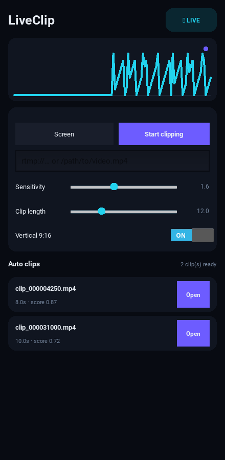

# LiveClip

Watches a live source — screen, camera, stream URL or a video file — finds the
hype moments on its own, and drops ready-to-post vertical clips while the
stream is still running.



## What it does

1. Records the source into short segments and keeps a rolling buffer.
2. Scores every 250 ms on loudness **and** on-screen motion.
3. Picks peaks that stand out from the local baseline.
4. Cuts each peak with pre/post roll, crops to 9:16 (or blurs the background),
   normalises loudness, adds fades, optionally burns in subtitles.
5. Shows the clip in the app the moment it is written.

No cloud, no upload, no account. Everything runs on the device.

## Install

```bash
pip install -e ".[ui]"     # engine + app
liveclip doctor            # checks ffmpeg, numpy, kivy
```

ffmpeg must be on `PATH` (or point `AUTOCLIP_FFMPEG` / `AUTOCLIP_FFPROBE` at it).

## Use

Open the app:

```bash
liveclip ui
```

Or stay on the command line:

```bash
# what would it cut?
liveclip detect stream.mp4 --sensitivity 1.8

# render clips from a recording
liveclip clip stream.mp4 -o clips --length 15 --count 3

# watch the screen and cut clips as things happen
liveclip live screen -o clips --length 12 --sensitivity 1.6

# watch a stream for 10 minutes
liveclip live rtmp://example.com/live -o clips --duration 600
```

Sources: `screen`, `camera`, any URL ffmpeg understands (`rtmp://`, `rtsp://`,
`http(s)://…m3u8`), or a local file path.

## Tuning

| Flag | Meaning |
| --- | --- |
| `--sensitivity` | 1.0 = calm, 2.5 = only huge moments (default 1.6) |
| `--length` | clip length in seconds, split as pre/post roll |
| `--count` | keep only the top N clips |
| `--blur` | blurred background instead of a centre crop |
| `--horizontal` | keep the source aspect ratio |
| `--subtitles clip.srt` | burn captions into the clip |
| `--buffer` | live rolling buffer in seconds (default 120) |

## How detection works

Audio is decoded to mono 16 kHz PCM and reduced to RMS loudness per 250 ms
frame. Motion is the mean absolute difference between consecutive 160×90 grey
frames at 4 fps. Each signal is compared with a rolling median baseline
(45 s), scaled by the median absolute deviation, and clamped to 0..1, so a quiet
podcast and a loud game stream are judged the same way. The two curves are
blended (65 % audio, 35 % motion by default) and peaks are taken greedily,
highest first, with a minimum spacing of 6 s.

That means it reacts to cheering, shouting, sudden music and big visual cuts —
not to steady background noise.

## Live mode

The recorder writes 2-second MP4 segments plus a CSV index. The monitor thread
scores the rolling window; once a peak's full post-roll has arrived, the clip is
cut from the buffered segments with the concat demuxer. Memory stays flat no
matter how long the session runs.

## Build a Windows EXE

```bash
pip install -e ".[ui]" pyinstaller
# put ffmpeg.exe and ffprobe.exe in packaging/pyinstaller/bin/
pyinstaller --noconfirm packaging/pyinstaller/liveclip.spec
```

The result is `dist/LiveClip.exe`, with ffmpeg bundled inside.
`.github/workflows/build-desktop.yml` builds Windows, macOS and Linux artifacts
on demand.

## Build an Android APK

```bash
pip install buildozer cython
buildozer -v android debug      # ~40 minutes, needs the SDK/NDK
```

The APK uses Kivy, numpy and the bundled ffmpeg. CI job:
`.github/workflows/build-android.yml`.

## Platform support

| Source | Windows | macOS | Linux | Android |
| --- | --- | --- | --- | --- |
| Screen | ✅ gdigrab | ✅ avfoundation | ✅ x11grab | ⏳ needs MediaProjection |
| Camera | ✅ dshow | ✅ avfoundation | ✅ v4l2 | ⏳ planned |
| Stream URL | ✅ | ✅ | ✅ | ✅ |
| Video file | ✅ | ✅ | ✅ | ✅ |

On Android, screen and camera capture require a MediaProjection foreground
service; until that lands the app tells you so instead of failing silently.

## Tests

```bash
python -m pytest        # 31 tests, ~20 s, needs ffmpeg
```

The suite generates its own test video (two loud flashes in 12 s) and asserts
that detection, planning, rendering and a full live session all behave.

## Layout

```
autoclip/
  config.py   tunable dataclasses
  media.py    ffmpeg/ffprobe wrappers
  detect.py   loudness + motion scoring, peak picking
  plan.py     clip windows, merging, top-N
  clip.py     ffmpeg render (9:16, blur, captions, loudnorm)
  live.py     segment recorder + rolling-buffer monitor
  cli.py      detect / clip / live / doctor / ui
  ui/app.py   Kivy app for desktop and Android
```
